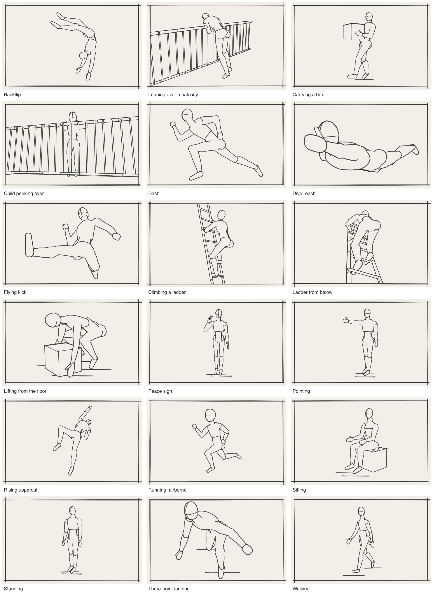

# ai-movie

A pipeline for making faceless videos, built around a programmatic storyboard step.

## Why a storyboard step

Text prompts are a weak way to control composition. A video or image model
decides for itself where the camera sits, how a figure is foreshortened, and
where people stand and look. This project fixes those choices first, in a
storyboard frame, and hands generation a shot that is already composed.

## Pipeline

| Stage | What it does | Status |
|---|---|---|
| 1. Script | Break an idea into narrated shots | Not started |
| 2. Storyboard | Turn each shot into a composed frame: body, pose, gaze, props, camera | Prototype in [`lib/pose`](lib/pose) |
| 3. Generation | Produce the final shot from the storyboard frame | Not started |
| 4. Voice | Narration with timing data | Not started |
| 5. Captions, music | Subtitles and sound | Not started |
| 6. Assembly | Cut visuals to audio and render | Not started |
| 7. Publish | Titles, thumbnails, upload, scheduling | Not started |

How stage 2 feeds stage 3 is still open: the frame can be passed to a model as
a reference image, or converted into a precise shot description in words.

## Storyboard approach

A frame is drawn from a small scene record, with no image model involved:

- **Body profile**: proportions for toddler, child, teen, adult, middle age
  and old, with female and long-torso / long-leg variants.
- **Pose**: joint angles relative to a three-piece spine, each with a
  permitted range, plus a flexibility setting for acrobatic poses.
- **Gaze**: a point to look at; the neck and head are solved to face it.
- **Reach targets**: optional points for hands and feet, so they can land on
  rungs, rails and boxes.
- **Props and camera**: boxes and bars, and a perspective camera with tilt.

Code projects the figure in perspective and draws it as a rough,
hand-sketched mannequin of a clothed form.

Known gaps: no rooms, streets or lighting yet, and each scene record is still
written by hand rather than produced from a shot description.

## Repository layout

| Path | What it holds |
|---|---|
| [`AGENTS.md`](AGENTS.md) | Rules and context for coding agents working in this repo |
| [`docs/planning`](docs/planning) | The project plan, the source of truth for intent |
| [`.beads`](.beads) | Work items (beads), managed with `br`; `issues.jsonl` is the committed record |
| [`lib/pose`](lib/pose) | The storyboard mannequin: renderer, body profiles, command line, and the scene-record format |
| [`resource/pose`](resource/pose) | Reference poses and shots, each as a scene record (`.json`) with its render (`.png`) |

Render a scene (Node.js, no dependencies):

```sh
node lib/pose/cli.js render resource/pose/dash.json
```



## Status

Early. Only the storyboard step exists, as a prototype. The plan is at draft 1, and work is tracked as beads: run `br ready` to see what can be picked up now.

## Acknowledgements

The way this project is planned and built draws on **Agent Flywheel**,
Jeffrey Emanuel's "Agentic Coding Flywheel" method: plan thoroughly in
markdown, turn the plan into a dependency graph of small work units, and run
coordinated coding agents against it.
See <https://agent-flywheel.com/complete-guide>.
